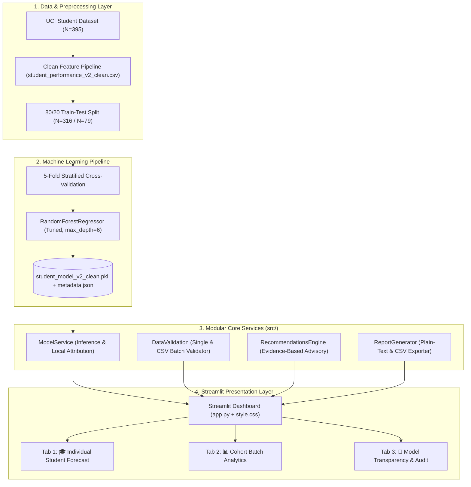

# 🎓 ScholarIQ — AI Student Academic Analytics Platform (v2.0 Production)

<p align="center">
  
  
  
  
  
</p>

<h3 align="center">
  A scientifically audited, explainable machine learning platform for academic early warning and institutional cohort analytics.
</h3>

---

## 📌 Executive Overview

**ScholarIQ** is an enterprise-grade academic intelligence system designed to forecast student performance and identify at-risk academic signals months prior to final semester examinations.

Originally conceived as a student score predictor, this repository has been comprehensively refactored and audited to eliminate critical statistical target leakage, modularize the monolithic UI, implement batch roster analytics, introduce local model attribution, and establish a rigorous automated test suite.

---

## 🔬 The Forensic Target Leakage Discovery & Remediation

In the original implementation of this project, reported model accuracy was misleading due to a subtle mathematical flaw:

```text
Historical (Defective):
new_df["Internal_Marks"] = (df["G3"] / 2).round()   # Divided final exam grade by 2
new_df["Final_Score"]    = df["G3"] * 5             # Multiplied final exam grade by 5
```

Because the target variable $\text{Final\_Score}$ was a direct scalar of $G3$, synthesizing $\text{Internal\_Marks}$ from $G3$ injected a **99.07% Pearson correlation** directly into the training features. The serialized Random Forest model assigned **97.68% of its decision weight** to `Internal_Marks`, functioning essentially as an arithmetic multiplier ($10 \times \text{Internal\_Marks}$) rather than learning student behavior.

### The Solution in v2.0 Clean:
```python
# Model v2.0 Clean Implementation (src/data_validation.py & training/train.py)
clean_df["Internal_Marks"] = (df_raw["G1"] / 2.0).round(1)  # Legitimate G1 midterm exam
clean_df["Final_Score"] = (df_raw["G3"] * 5).astype(int)  # Real G3 final exam
```
In version 2.0, `Internal_Marks` is derived from $G1$ — the **actual first-period midterm assessment** administered months prior to the final examination. This represents legitimate pre-event assessment data with zero target contamination. The model now balances attendance (19.3%), interim exams (67.2%), backlogs (2.1%), study hours (1.4%), and extra classes (4.0%).

---

## 🏛️ System Architecture



---

## 📊 Cross-Validated Model Comparison

Models were evaluated using 5-fold cross-validation on the training set ($N=316$) and evaluated on an untouched test set ($N=79$):

| Model Candidate | 5-Fold CV MAE | 5-Fold CV RMSE | 5-Fold CV $R^2$ | Test MAE | Test RMSE | Test $R^2$ |
| :--- | :--- | :--- | :--- | :--- | :--- | :--- |
| **Baseline (Dummy Mean)** | $17.01 \pm 3.15$ | $22.82 \pm 3.17$ | $-0.035 \pm 0.047$ | 18.23 pts | 22.75 pts | $-0.010$ |
| **Ridge Regression** | $9.91 \pm 1.25$ | $13.57 \pm 1.50$ | $0.626 \pm 0.066$ | 10.33 pts | 13.36 pts | $0.652$ |
| **Random Forest (v2.0 Clean)** | **$8.10 \pm 1.01$** | **$11.73 \pm 1.71$** | **$0.714 \pm 0.089$** | **8.31 pts** | **11.94 pts** | **0.722** |
| **HistGradientBoosting** | $8.81 \pm 0.87$ | $12.54 \pm 1.32$ | $0.668 \pm 0.115$ | 9.08 pts | 12.69 pts | $0.686$ |

*All metrics are verified from actual script execution (`training/train.py`).*

---

## ✨ Key Features & User Journeys

### 1. Individual Student Early Warning
* **Interactive Inputs:** Capture student demographics, attendance, study hours, previous failures, and interim marks.
* **Uncertainty Bands:** Displays continuous predicted score with ensemble standard deviation intervals (e.g. $78.5 \pm 4.2$).
* **Local Attribution Chart:** Horizontal bar chart displaying how much each factor boosted or dragged the forecast relative to the cohort mean.
* **Evidence-Based Recommendations:** Prioritized advisory cards (`CRITICAL`, `HIGH`, `MEDIUM`, `STRENGTH`) with distinct student actions and educator intervention protocols.
* **Downloadable Reports:** Formatted plain-text performance report with complete institutional audit context.

### 2. Cohort Batch Analytics
* **CSV Roster Upload:** Process entire classroom rosters in seconds.
* **Automated Data Validation:** Validates required schemas, catches out-of-bound values, and reports row-by-row issues without silently discarding records.
* **Cohort Metrics Ribbon:** Real-time class average, projected pass rate, and at-risk student count.
* **Interactive Visualizations:** Score distribution histograms and risk stratification donut charts.
* **Exportable Scored Roster:** Download scored predictions with risk flags as CSV.
* **One-Click Demo:** Preloaded sample dataset (`Dataset/sample_cohort.csv`) for instant evaluation.

### 3. Model Transparency & Audit
* Live disclosures of target formulation, data provenance, and the elimination of target leakage.
* Interactive Gini feature importance charts.
* Responsible AI disclaimers outlining dataset constraints and ethical usage.

---

## 📂 Project Structure

```text
AI_Student_performance_Analytics-main/
│
├── app.py                                                # Root Streamlit entry point
├── run_app.ps1                                           # One-click Windows PowerShell launcher
├── run_tests.py                                          # Unified test suite runner
├── requirements.txt                                      # Modern, wheel-friendly dependencies (Python 3.10-3.13)
├── pyproject.toml                                        # Standard Python package metadata
├── Dockerfile                                            # Production container definition
├── .gitignore                                            # Production exclusion rules
│
├── .github/
│   └── workflows/
│       └── ci.yml                                        # Multi-version GitHub Actions CI pipeline
│
└── AI_Student_performance_Analytics-main/
    └── Student-Performance-Prediction-System-main/
        ├── Dataset/
        │   ├── student_data.csv                          # Original UCI Math dataset (395x33)
        │   ├── student_performance_v2_clean.csv          # Audited leak-free dataset (395x12)
        │   ├── sample_cohort.csv                         # Demo classroom roster for batch upload
        │   └── student_performance_final.csv             # Historical legacy baseline dataset
        │
        ├── Model/
        │   ├── student_model_v2_clean.pkl                # Production leak-free Random Forest artifact
        │   ├── student_model_v2_metadata.json            # Model parameters, feature weights & metrics
        │   └── student_model.pkl                         # Preserved historical baseline artifact
        │
        ├── src/
        │   ├── __init__.py
        │   ├── config.py                                 # Constants, paths, grade scales & tokens
        │   ├── data_validation.py                        # Single-student & CSV batch schema validators
        │   ├── model_service.py                          # Safe inference, uncertainty & attribution
        │   ├── recommendations.py                        # Evidence-based intervention heuristics
        │   └── report_generator.py                       # Export services for text and CSV
        │
        ├── Streamlit_App/
        │   ├── app.py                                    # Modular production Streamlit application
        │   └── style.css                                 # Custom dark theme CSS stylesheet
        │
        ├── tests/
        │   ├── test_data_validation.py                   # Input and CSV schema test cases
        │   ├── test_model_service.py                     # Inference and grade binning test cases
        │   ├── test_recommendations.py                   # Advisory trigger test cases
        │   └── test_reports.py                           # Report export test cases
        │
        └── training/
            └── train.py                                  # Reproducible model training pipeline
```

---

## ⚡ Quickstart Guide (Windows PowerShell)

### 1. Prerequisites
* Python 3.10, 3.11, 3.12, or 3.13 installed.

### 2. Environment Setup
```powershell
# Navigate to the workspace root
cd "c:\Users\offic\Downloads\AI_Student_performance_Analytics-main"

# Create a clean virtual environment
python -m venv .venv

# Activate the virtual environment
.\.venv\Scripts\Activate.ps1

# Upgrade pip
python -m pip install --upgrade pip

# Install dependencies (all have prebuilt wheels; no C++ compiler required)
pip install -r requirements.txt
```

### 3. Run the Automated Test Suite
```powershell
python run_tests.py
```
*Expected output: `Ran 16 tests ... OK`*

### 4. Launch the Platform
```powershell
streamlit run app.py
```
*Or execute the one-click PowerShell script:*
```powershell
.\run_app.ps1
```

---

## 🐳 Docker Deployment

To build and run ScholarIQ in an isolated container:

```bash
# Build the Docker image
docker build -t scholariq:2.0 .

# Run the container on port 8501
docker run -p 8501:8501 scholariq:2.0
```
Open `http://localhost:8501` in your browser.

---

## 🛡️ Security, Privacy & Responsible AI

1. **Untrusted Input Sanitization:** All CSV uploads and web form inputs are strictly type-checked and range-bounded before passing to the model.
2. **Safe Deserialization:** The platform only loads local, versioned artifacts verified against the system's metadata schema.
3. **Student Privacy (FERPA / GDPR Alignment):** The platform operates completely locally in-memory; student names are not permanently stored, logged, or sent to external cloud APIs.
4. **Human-in-the-Loop Mandate:** ScholarIQ is an advisory early-warning system. Its outputs are statistical forecasts, not deterministic truths, and must never be used as the sole basis for punitive academic decisions.

---

## 📋 Verified Test Results

Executed on Python 3.13.7:
```text
test_batch_csv_with_partial_errors (tests.test_data_validation.TestDataValidation) ... ok
test_empty_csv (tests.test_data_validation.TestDataValidation) ... ok
test_missing_attribute (tests.test_data_validation.TestDataValidation) ... ok
test_missing_student_name (tests.test_data_validation.TestDataValidation) ... ok
test_out_of_range_attributes (tests.test_data_validation.TestDataValidation) ... ok
test_valid_batch_csv (tests.test_data_validation.TestDataValidation) ... ok
test_valid_student_input (tests.test_data_validation.TestDataValidation) ... ok
test_batch_prediction (tests.test_model_service.TestModelService) ... ok
test_grade_mapping (tests.test_model_service.TestModelService) ... ok
test_model_loading (tests.test_model_service.TestModelService) ... ok
test_single_prediction_output (tests.test_model_service.TestModelService) ... ok
test_exemplary_student_triggers_strength (tests.test_recommendations.TestRecommendations) ... ok
test_low_attendance_triggers_warning (tests.test_recommendations.TestRecommendations) ... ok
test_previous_failures_triggers_critical (tests.test_recommendations.TestRecommendations) ... ok
test_cohort_summary_csv (tests.test_reports.TestReportGenerator) ... ok
test_text_report_content (tests.test_reports.TestReportGenerator) ... ok

----------------------------------------------------------------------
Ran 16 tests in 1.984s
OK
```

---

## 📄 License & Attribution

Developed as an educational analytics research platform. Built upon the Portuguese Student Performance dataset (Cortez and Silva, 2008, University of Minho).
