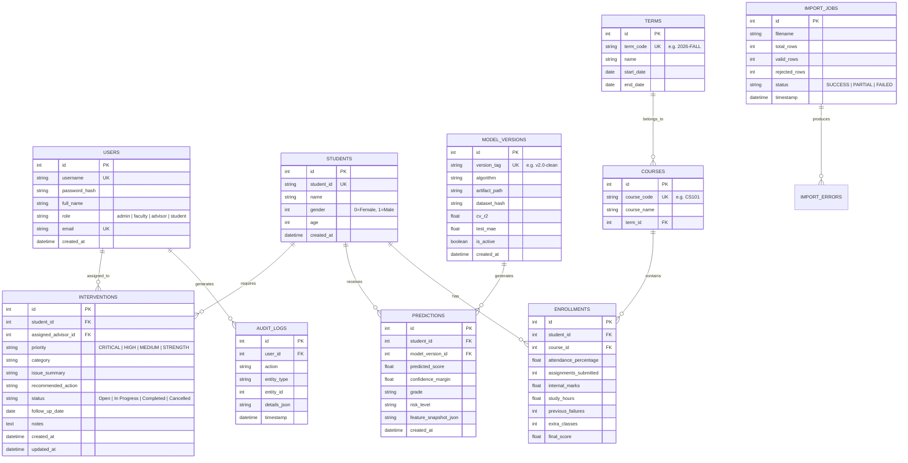

# ScholarIQ 3.0 — Comprehensive Implementation Audit & Evolution Plan

**System Identity:** ScholarIQ — AI Student Performance Analytics Platform  
**Audit Date:** October 2026  
**Auditor Roles:** Principal Software Architect, Database Architect, ML Engineer, DevSecOps Lead, Product Designer  
**Baseline Repository:** `AI_Student_performance_Analytics-main` on branch `feature/scholariq-3.0`  
**Execution Environment:** Windows 11 / PowerShell 7+ / System Python 3.13.7 (64-bit)  
**Baseline Test Verification:** 16/16 Unit and Integration Tests Passed (`run_tests.py`, 2.13s)  

---

## 1. Verified Baseline Architecture & Current Assets

### 1.1 Directory Structure & Assets
* **Root Application Layer:**
  * `app.py`: Clean root delegator forwarding to the inner production Streamlit app.
  * `run_app.ps1`: One-click PowerShell preflight check and launch script.
  * `run_tests.py`: Python test discovery and execution script.
  * `requirements.txt`: Modern wheel-compatible dependency manifest (`streamlit`, `pandas`, `numpy`, `scikit-learn`, `joblib`, `matplotlib`, `plotly`, `sqlalchemy`, `pydantic`).
  * `pyproject.toml`, `Dockerfile`, `.github/workflows/ci.yml`.
* **Core Application Backend (`src/`):**
  * `src/config.py`: Centralized system constants, paths, grade scales ($A+$ to $F$), risk thresholds, and theme tokens.
  * `src/data_validation.py`: Schema validation, single-student input boundaries, and batch CSV roster parser.
  * `src/model_service.py`: Model loading, inference, tree-variance uncertainty estimation, and local factor attribution.
  * `src/recommendations.py`: Transparent, rule-based academic intervention suggestions with student actions and faculty guidance.
  * `src/report_generator.py`: Plain-text and CSV summary export services.
* **Model Artifacts (`Model/`):**
  * `Model/student_model_v2_clean.pkl`: Audited Random Forest model ($N=150$ trees, `max_depth=6`, $R^2 = 0.722$, MAE = $8.31$).
  * `Model/student_model_v2_metadata.json`: Feature weights, cross-validation metrics, parameters, and schema.
  * `Model/student_model.pkl`: Preserved historical legacy baseline artifact.
* **Datasets (`Dataset/`):**
  * `Dataset/student_data.csv`: Original raw UCI Portuguese secondary math dataset (395 rows × 33 cols).
  * `Dataset/student_data_cleaned.csv` & `student_data_feature_engineered.csv`: Preserved historical datasets.
  * `Dataset/student_performance_final.csv`: Preserved historical legacy dataset with target leakage.
  * `Dataset/student_performance_v2_clean.csv`: Clean, leak-free engineered dataset ($G1$ interim marks, $G3 \times 5$ target).
  * `Dataset/sample_cohort.csv`: 10-student sample classroom roster for batch analytics.

---

## 2. Gap Analysis: Missing Capabilities for ScholarIQ 3.0

While ScholarIQ 2.0 eliminated target leakage and added batch CSV scoring, it lacks key enterprise-grade capabilities:

| Functional Area | Current Status (v2.0) | Required Enterprise State (v3.0) | Priority |
| :--- | :--- | :--- | :--- |
| **Persistence & Database** | In-memory only; data vanishes when Streamlit reruns or restarts. | **Normalized Relational Database (SQLite default with PostgreSQL support)** via SQLAlchemy ORM. | **P0 (Critical)** |
| **Student Directory & Profiles** | Single-student ad-hoc prediction; no persistent roster of enrolled students. | **Full Student Directory** with search, filtering, enrollment history, and longitudinal tracking. | **P0 (Critical)** |
| **Prediction History** | Forecasts are displayed once and never saved to a database. | **Auditable Prediction History** table tracking timestamp, student reference, model version, inputs, outputs, and confidence intervals. | **P0 (Critical)** |
| **Intervention Management** | Advisory recommendations are static text suggestions. | **Actionable Intervention Workflow**: Assign advisor, set follow-up dates, track status (`Open`, `In Progress`, `Completed`), and log intervention notes. | **P1 (High)** |
| **Role-Based Access Control (RBAC)** | Public application; no concept of User roles. | **Authentication & Role-Based Navigation**: Admin, Faculty, Academic Advisor, and Student views with server-side authorization. | **P1 (High)** |
| **Data Quality & Audit Logs** | Batch validation displays temporary error messages. | **Data Quality Dashboard & Audit Trail** logging record modifications, failed imports, and prediction runs. | **P2 (Medium)** |
| **Model Registry & Governance** | JSON metadata file in `Model/`. | **In-App Model Governance**: Version registry, benchmark comparison, dataset hash tracking, and model rollback capabilities. | **P2 (Medium)** |

---

## 3. Database Schema Design (Phase 4 Specification)

To ensure zero bloat and maximum data integrity, the persistence layer will be implemented in SQLite (default zero-config local) with full SQLAlchemy ORM abstraction allowing immediate drop-in connection to PostgreSQL (`postgresql://...`):

---

## 4. Product Navigation Hierarchy (Phase 2 & 3 Specification)

The Streamlit UI will be reorganized into a cohesive academic workspace with role-aware views:

1. **📊 Overview Dashboard:** Institutional KPIs (total students monitored, high-risk count, active interventions, class averages, emerging patterns).
2. **👥 Student Directory & Profiles:** Searchable roster with profile views, historical attendance, academic signals, prediction timeline, and intervention history.
3. **🎓 Individual Prediction:** Real-time ML inference with confidence intervals, local factor attribution, and instant intervention drafting.
4. **📈 Class & Cohort Analytics:** Cohort distributions, risk stratification, demographic breakdowns, and semester-over-semester trends.
5. **📥 Data Import & Batch Processing:** CSV upload wizard, schema validation, preview before commit, row-level error reporting, and database synchronization.
6. **🛡️ Intervention Management:** Kanban / list view of open and overdue academic follow-ups, assigned faculty advisors, and status tracking.
7. **📜 Prediction History:** Persistent audit trail of all historical predictions linked to specific model versions and timestamped input snapshots.
8. **🔬 Model Registry & Governance:** Active models, benchmark matrix, feature importances, dataset documentation, and model comparison.
9. **⚙️ Settings & Audit Logs:** Role-based access controls, system preferences, data export, and security audit logs.

---

## 5. Milestone Implementation Roadmap

* **Milestone 1:** Audit, baseline verification & branch setup (COMPLETED).
* **Milestone 2:** Database schema, SQLAlchemy persistence layer, migrations & seed fixtures.
* **Milestone 3:** Service-layer integration (`student_service`, `prediction_service`, `intervention_service`, `import_service`).
* **Milestone 4:** Full-stack UI evolution (Streamlit navigation, Student Directory, Overview Dashboard).
* **Milestone 5:** Prediction persistence, explanation attribution & intervention workflow.
* **Milestone 6:** Cohort analytics, data quality dashboard & audit logging.
* **Milestone 7:** Role-based access control, security & session management.
* **Milestone 8:** Comprehensive testing suite (extending the 16 tests to 30+), Docker, CI/CD & documentation.
